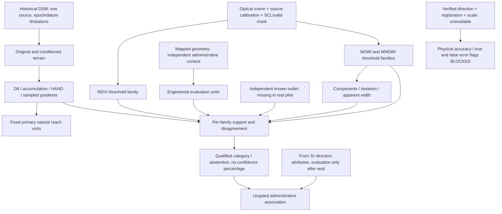

# SATQUERY — MULTISCALE DRAINAGE CONSISTENCY AND EVIDENCE FUSION EXPERIMENT

**12 November 2026. DEVELOPMENT ONLY pilot.** The implemented pilot and independent arithmetic checks completed. **An improvement in physically validated drainage direction or detection of real DEM-routing errors was not established.** We obtained reproducible disagreement and sensitivity measurements, an important negative engineered-drainage diagnostic, and explicit abstentions where the observations or references cannot support direction.

Read this report with the machine-readable [verified measurements](C:/Users/nrgen/.codex/.chatgpt-projects/g-p-6ad52225bccc8191b1ed5af2ed6b0646/drainage-consistency-20261112/repo/research/results/drainage-consistency-20261112/verified-v3-recount2/independent-recount.json). No exposure, flood-prediction, new-algorithm novelty or operational safety result is claimed.

Statuses: **VERIFIED** means supported within the stated computational population; **DEVELOPMENT ONLY** denotes inspected/exploratory data; **PARTIAL** means only part of a target was examined; **BLOCKED** means a prerequisite is absent; **NOT TESTED** means no corresponding valid experiment ran; **HYPOTHESIS** denotes an explanation or proposed benefit awaiting validation.

## 1. Repository audit and reused methods

GitHub main was refreshed and remains `f53fa04e7e33ba6beddc72e7cb349a488261aa45`. Work is isolated on **`codex/drainage-consistency-20261112`**, in the checkout linked in section16. The original campaign/VQA checkout was not switched or modified. The immutable Day1 commit remains `f3945347cf0f0a4581aa1480c8fa1501a25da4b4` (annotated tag object `a08d2706397d359edb060993ee3a14374b3d136f`). No push, application integration or model training occurred.

Local implementation checkpoints:

- `112bb7e`: protocol, bounded acquisition adapter, features/decisions and initial passing tests.
- `9b3d8af2e3567a20fc22c4ec45a53bed8a65a16c`: native coarser-band processing, temporal/per-reach terrain measurements and grid regression.
- **`7762682964b8f15fe36a9552b5411c8ea6334bec`**: accepted measurement implementation, corrected BOA handling and outlet reversal safeguard. This is the source commit for accepted run-v3 and its repeat. Later reporting/checker files do not change these predictions.

The [pre-implementation audit](C:/Users/nrgen/.codex/.chatgpt-projects/g-p-6ad52225bccc8191b1ed5af2ed6b0646/drainage-consistency-20261112/repo/research/results/drainage-consistency-20261112/PRE_IMPLEMENTATION_AUDIT.md) preceded experimental code. It read the November5–8 research reports and readiness audit and identified the following reuse:

| Reused implementation, unchanged | Function / role |
|---|---|
| `research/terrain_exposure/hydrology.py` | `condition`, `derive`, `slope_aspect`, `path`: Priority-Flood, D8, accumulation, HAND, slope, catchments and open-boundary outlets. |
| `research/terrain_exposure/io.py` | `Grid`, `sha256`, `save_json`, necessary sampling gate. The one-million-cell grid guard was preserved. |
| `research/cases/process_campaign.py` | `metric_grid`, `warp`, `roi`, `roi_geometry`: metric sampling and declared ROI. |
| `research/datasets/cog.py` | Native-window geometry; original host restrictions were retained. A separate exact-host Sentinel COG adapter was added. |
| `research/experiments/delhi_drainage.py` | `load_layer`: retained source-hash-checked administrative geometry. No reference direction entered the predictors. |

The previous total-water WorldFloods experiment was not repeated: it is not a direction benchmark. No previously reserved WorldFloods activation, annotation pixel or aggregate label statistic was opened. Road-damage grades are irrelevant to this drainage target and were not used.

## 2. Relevant prior research and novelty comparison

The separately cited [primary-source review](C:/Users/nrgen/.codex/.chatgpt-projects/g-p-6ad52225bccc8191b1ed5af2ed6b0646/drainage-consistency-20261112/repo/research/results/drainage-consistency-20261112/PRIOR_RESEARCH.md) records exact sources and access limitations. Its main implications:

| Closest work | Existing contribution | Consequence here |
|---|---|---|
| [Nobre et al., HAND](https://doi.org/10.1016/j.jhydrol.2011.03.051) | Height relative to flow-connected drainage. | Drainage dependence is a methodological premise, not our discovery. |
| [Garousi-Nejad et al.,2019](https://doi.org/10.1029/2019WR024837), [AGREE](https://www.caee.utexas.edu/prof/maidment/GISHYDRO/ferdi/research/agree/agree.html) | Hydrography-informed terrain conditioning/enforcement. | Drainage correction and improving HAND through hydrography already exist. |
| [MERIT Hydro](https://doi.org/10.1029/2019WR024873) | Combines terrain and water-related evidence for hydrography. | DEM+water fusion is not new; related DEM/water lineage cannot be treated as independent truth. |
| [RivGraph/Schwenk et al.,2020](https://esurf.copernicus.org/articles/8/87/2020/) | Morphology, network rules and known inlets/outlets constrain link directions. | Closest methodological overlap; no first-ever combination or improved directional performance is established here. |
| RivaMap, RivWidth and GRWL | Spectral channel extraction, centerlines and apparent width. | Location/width are not the sign of flow. GRWL explicitly does not sort segments upstream/downstream. |
| USGS hydraulic geometry and DSWE | Conditional width/discharge relationships; multiple spectral tests/masks. | Width is not bathymetry; combining normalized indices is not itself novel. |

**Novelty status: NOT VERIFIED.** The possible contribution is an evaluated disagreement/abstention contract under declared support and dependence conditions. This pilot supplies empirical limitations and reproducibility, not a new hydrological algorithm or superiority claim. Some papers were abstract- or access-limited; this is a bounded primary-source review, not exhaustive literature coverage or competitor replication.

## 3. Scientific hypotheses

- **HYPOTHESIS H1:** spectral corridor continuity can identify some unreliable DEM routes. It requires independent correct/incorrect routing labels to test error detection.
- **HYPOTHESIS H2:** NDVI occupancy/continuity/contrast adds useful ambiguity information beyond terrain. Multiple thresholds from one image are correlated features.
- **HYPOTHESIS H3:** resolved width/morphology plus independent outlet constraints improves direction on eligible reaches. Widening alone is not a direction rule.
- **HYPOTHESIS H4:** fusion improves the tradeoff between correct flags, false disagreements and useful answers compared with terrain alone.

**Current hypothesis verdict:** no H1–H4 improvement is demonstrated. The pilot measures candidate disagreements, dependence and missingness; verified physical direction/error targets are unavailable. A permissive ungated water-absence rule produces extensive warnings against known mapped engineered drains, which cautions against treating those warnings as errors.

## 4. Experimental methodology and equations

The unchanged terrain engine uses original elevation z and conditioned elevation zf. Priority-Flood raises a visited neighbour j to `max(z[j], zf[parent])`; NoData and open domain boundaries stay explicit. D8 chooses maximum positive `(zf[i]−zf[j])/distance(i,j)`, routing filled flats by the established parent/visit ordering. Accumulation sums upstream valid cells; streams exceed a declared contributing-area threshold. `HAND[i]=z[i]−z[first downstream stream cell]`; unavailable/negative unsupported values remain unknown. These are historical DSM derivatives, not hydraulics.

**Primary terrain:** native historical GLO30, bilinear metric30m, fill conditioning, stream area100,000m². **Sensitivity:**30/90m ×fill/none ×50,000/100,000/200,000m² =12 settings per case,36 case-setting records. It is the same terrain source resampled, not two independently measured DEMs. Here terrain is clipped to the declared ROI, with open edges; it is not the earlier buffered Nepal graph domain, nor a complete basin.

**Fixed units:** natural-case primary D8 reaches between junctions/endpoints, split at300m and retained when ≥90m; shared endpoints do not make independent rivers. Nineteen Nepal and347 Varanasi short/singleton pieces were excluded by that fixed rule. Engineered units are positive-length clipped mapped drain features. Alternative terrain settings are sampled on these same unit geometries. No result-driven reach selection was used.

At interior quadrature points every10m along a unit:

`NDVI=(NIR−RED)/(NIR+RED)`

`NDWI=(GREEN−NIR)/(GREEN+NIR)` — McFeeters formulation, not Gao NDWI.

`MNDWI=(GREEN−SWIR16)/(GREEN+SWIR16)`

Use real SCL in{4,5,6}, source-valid finite nonnegative contributing reflectances and denominator magnitude>1e−8. Unknown/negative reflectance is excluded, not clipped into a plausible index. Nepal's saved grid is10m with originally coarser SWIR/SCL; urban indices use the required native20m SWIR/SCL grid, retaining no invented10m detail. Shared coordinates do not establish physical registration.

**Radiometry correction:** the Earth Search item flag `earthsearch:boa_offset_applied=true` means use the recorded scale without subtracting the offset again. When false, retain the explicit asset offset; missing convention fails closed. Three selected scenes have true and Sangam2024 has false. This resolves a documented contradiction between item and asset metadata; it is **provider-convention calibration, not independent radiometric certification**. Known upstream flag issues remain a limitation, especially for the false-flag scene. [Provider discussion](https://github.com/Element84/earth-search/issues/9), [later anomaly reports](https://github.com/Element84/earth-search/issues/71).

Water masks use thresholds−0.1,0,0.1 for both indices. For threshold t, compute fraction of clear points within30m of detected water, largest connected water-component fraction and longest contiguous supported sample run. Four-connected components are a spectral morphology convention, not hydraulic connectivity. Primary disagreement requires ≥80% clear sample support and **<20% near-water support at every MNDWI threshold**. NDWI is a separate sensitivity diagnostic; the decision rule does not count it as another independent vote.

Vegetation features include below-threshold occupancy/contiguous run for NDVI thresholds0,0.2,0.4; median NDVI; and path-versus-two-flanks contrast sampled75m either side. Occupancy range>0.4 marks designation sensitivity. This is greenness/threshold sensitivity, not vegetation density, discharge or direction.

Width uses a skeleton of MNDWI>0, twice the within-water distance transform at eligible nearby skeleton points. Widths near unknown/image boundaries are censored; retain apparent diameters≥40m and at least5 samples per unit. The median pairwise slope `median((w[j]−w[i])/(s[j]−s[i]))` describes width trend along the **computational** orientation. It changes sign if the path is reversed, so it cannot certify that orientation. This diameter is not a surveyed bank-to-bank hydraulic cross section or riverbed depth. Confluence-resolving hydraulic geometry, incision measurement, braiding/bifurcation resolution and reservoir backwater modeling were **NOT TESTED**.

Record original and conditioned endpoint surface gradients separately, maximum sampled fill, modeled HAND and slope. No independent incision or bathymetry measurement is inferred. Temporal features use common valid sample coordinates at both dates and the same80% support rule; median NDVI difference/two-date water persistence remain unregistered conditional observations, not permanent-water or physical-flow truth.

**Decision categories:** declared scale→required clear support→robust spectral disagreement→required outlet availability/connectivity→width availability/NDVI ambiguity→qualified outlet/water consistency→otherwise ambiguous. Natural nominal target width60m is an engineering scope choice, not a measured width; engineered target1m is the previously documented inventory median. At least two terrain cells are required across that target. The gate alone cannot prove suitability. All component features are retained even when the first category preempts later checks; probabilities are null.

`SUPPORTED_DIRECTION` is reachable only with supplied independent outlet consistency plus observed corridor support and no earlier failure. Real pilot outlets supplied=0, so **no physical direction assertion was emitted**. A DEM domain exit is not relabelled a known physical outlet. Outlet/evaluation source-ID overlap is rejected, and a route starting at an outlet and moving away does not pass the terminal-outlet check. Those behaviors have synthetic regression tests; their real-data benefit remains blocked.

## 5. Evidence dependency diagram



NDVI/NDWI/MNDWI share pixels/bands/quality artifacts. Width and spectral connectivity derive from the same water masks. HAND, gradient, accumulation and D8 share the same terrain. More layers are not more independent experiments. Administrative geometry defines engineered evaluation support, but its direction annotations and node labels never construct predictions or outlets.

## 6. Data source and reference eligibility matrix

| Case | Sources and dates | What was usable | Direction/reference limitation |
|---|---|---|---|
| Nepal | Retained Sentinel2 cubes22/27Aug2026; frozen native GLO30, acquired in the previous campaign. |68 fixed natural reaches;24/68 primary clear eligible;20/68 common-date eligible. |No independently verified directed natural network or known physical outlet. Physical registration unverified. Post-event2m terrain excluded. |
| Varanasi | Public Sentinel2 `S2A_44RPP_20231027_0_L2A`, `S2A_44RPP_20241031_0_L2A`; retained GLO30. |2,184 fixed natural reaches;2,162/2,184 primary clear eligible;2,155/2,184 common-date eligible. |No independent directional reference/outlet; primary D8 units bias spatial coverage toward the baseline. These are autumn2023/2024 observations, not the earlier2017/2023 modeled urban-change evaluation. |
| Sangam Vihar | Public Sentinel2 `S2A_43RGM_20231006_0_L2A`, `S2C_43RGM_20241030_1_L2A`; retained GLO30; previously inspected GSDL native drains. |83 clipped mapped units;83/83 primary clear eligible;49/83 common-date eligible under physical-index masks. |Nominal1m drains fail30/90m sampling. From/To+node annotations allow an administrative association diagnostic only. Dates/field accuracy/completeness and local registration remain unverified. |

Urban selection was prespecified: first full-ROI item ranked by metadata cloud fraction/date/ID in each bounded100-item response for October–November2023/2024. All four searches were truncated; the chosen item is the best under the **returned bounded population**, not guaranteed globally least cloudy. No reference, pixel quality or resulting score selected a replacement scene. Four native six-band crops retained **35,141,593 compressed bytes (~33.51MiB)**; this measures local retained data, not total HTTP/block transfer. Their metadata, calibration declarations, URLs, ETags and crop hashes are retained privately.

The official GSDL reference was already consumed development material. It is public mapping with unknown redistribution/ground-verification terms, not surveyed flow truth. Native90 feature records produce83 positive clipped units. Of83 direction diagnostics,81 have endpoint-consistent administrative annotation,2 fail the1m endpoint matching check, and1 of those81 has no usable local D8 vector; thus80 are orientable for the ungated comparison. A single `IL_MSL` per feature cannot establish endpoint hydraulic gradient.

GRWL is eligible for location/width only, MERIT/NHDPlus raster flow shares terrain derivation, and NHD vector FlowDir is a conditional licensed prospect with source-lineage/vintage checks still needed. No new independent physical direction reference was acquired. The four WorldFloods reserve activations were neither needed nor consumed.

## 7. Implemented pilot experiments and verification

Accepted **run-v3** processed **2,335 fixed units across the three cases**, with no pooling as independent rivers. Each case ran A–F plus four leave-one-family-out arms; the30 arm×case rows are repeated evaluations of the same units. Each case also ran12 terrain settings, producing36 sensitivity rows. Spectral index thresholds were unchanged after source corrections.

Implementation/quality attempts are preserved:

| Attempt | Outcome / consequence |
|---|---|
| Optical attempt1 | Older source helper rejected the newly used host before pixels. New exact-host adapter added; original helper was not relaxed. |
| Optical attempt2 | Four bounded public observations acquired. Metadata/raw bytes remain unchanged. |
| Run-v1 | Nepal completed; Varanasi10m crop hit the existing one-million-cell guard. Retained as a failed integration run; no guard increase. |
| Run-v2 | Completed, but urban indices exposed duplicate BOA offset correction. Spectral results **REJECTED**, not an alternative scientific arm. |
| Run-v3 | Corrected metadata-convention calibration and nonnegative-index quality checks; accepted measurements. |
| Recount attempt1 | Checker incorrectly assumed JSON/CSV arm order matched. Fixed to join case+arm identities; no predictions changed. |
| Recount attempt2 | **PASS:**24 output-manifest files and31 retained input records hash-checked;30 ablation rows independently recounted;36 sensitivity ratios checked; physical evaluation remains null. |
| Run-v4-repeat | Same-input repeat:23/24 manifest-listed files byte-identical; the scientific summary is identical after excluding elapsed seconds. This is deterministic reproduction, not another independent trial. |

**Tests: VERIFIED software behavior.** The19 pilot tests and24 existing scientific regressions passed, in separate logged test sets. They cover known index values, missingness, scale, correlated evidence, reference leakage, outlet reversal, width reversal, geometry-order/reference matching, coarse-band processing, duplicate-offset prevention and identity-based independent recount. They do not certify real geophysical accuracy. No GPU model, application browser flow or field observation was tested by this experiment.

Both previous November7 release manifests still match:78/78 and81/81 files respectively. Inherited terrain source files also remain byte-identical. See `HISTORICAL_INTEGRITY.json`, `REPEAT_VERIFICATION.json` and the verification identities.

## 8. Ablation results with denominators

Arm definitions: A terrain; B A+vegetation; C A+water observations; D A+morphology/width; E A+known outlet; F all families. The complete30-row CSV includes targeted ablations. Counts below are **qualified output categories, not accuracy**. “No observation” includes missing resolved widths in D. All arms assert0 physical directions.

| Case / n | Arm | Corridor conflict | Ambiguous | Scale insufficient | Observation insufficient | Outlet unavailable |
|---|---|---:|---:|---:|---:|---:|
| Nepal /68 | A |0|68|0|0|0|
| | B |0|24|0|44|0|
| | C |14|10|0|44|0|
| | D |0|3|0|65|0|
| | E |0|0|0|0|68|
| | F |14|0|0|44|10|
| Varanasi /2,184 | A |0|2,184|0|0|0|
| | B |0|2,162|0|22|0|
| | C |1,941|221|0|22|0|
| | D |0|46|0|2,138|0|
| | E |0|0|0|0|2,184|
| | F |1,941|0|0|22|221|
| Sangam /83 | A–F, each arm separately |0|0|83|0|0|

**Targeted ablations:** F without vegetation or without morphology has the same final counts as F in both natural cases. This is structural preemption: spectral conflict and missing outlet occur before those later checks. It **does not prove that vegetation/morphology is useless**. F without water removes those conflicts and yields24 Nepal/2,162 Varanasi outlet-unavailable cases after the clear gate. F without outlet yields Nepal14 conflicts,3 ambiguous,51 observation-insufficient; Varanasi1,941 conflicts,45 ambiguous,198 observation-insufficient. All engineered leave-one-out arms remain83/83 scale-insufficient. Underlying features are reported separately to expose this gate dominance.

**Useful-answer coverage:** no verified-direction eligible denominator exists; physical directional accuracy, correctly identified real errors and false-error rate are **null/BLOCKED**, not0% or100%. Overall abstention from physical direction is68/68,2,184/2,184 and83/83. Spectral assessment coverage is24/68,2,162/2,184 and83/83 before the engineered scale gate; these different coverage concepts must not be confused.


## 9. Identified disagreements: measured observations versus unverified errors

**VERIFIED computational observations / DEVELOPMENT ONLY interpretation:**14/24 clear-eligible Nepal reaches and1,941/2,162 clear-eligible Varanasi reaches meet the robust MNDWI corridor-disagreement rule. These are model stream paths lacking nearby optical water under the prescribed thresholds, not independently confirmed false D8 routes. The full selected-unit denominators remain68 and2,184.

Examples are the first qualifying units in deterministic source order, not best-looking failures: `nepal:5162:0`, `nepal:5484:0` and `varanasi:3451:0` have near-water fractions[0,0,0] across the three MNDWI thresholds on eligible clear support. Exact sample support and category traces are in `disagreement-examples.json`; full geometries/features are in the private accepted run.

Natural DEM-derived streams can be ephemeral, covered, irrigated, below optical scale or simply unobserved as open water. The observed disagreement is real relative to these masks; its physical explanation is **HYPOTHESIS** until an independent channel/flow reference resolves it. “Correctly identified DEM errors” remains **BLOCKED**.

## 10. Incorrect disagreement cases and engineered negative diagnostic

The strict system does not flag the1m engineered drains as proven direction conflicts; the scale gate abstains first. Nevertheless, inspecting the underlying **ungated** spectral rule is revealing:79/83 mapped drains lack the required nearby water support, despite all83 meeting the primary clear-support gate.

The independent administrative annotation gives **48/80 majority D8 agreements and32/80 disagreements** among orientable units. This is a60% association with the supplied map's From→To orientation, **not physical-direction accuracy**. Two endpoint-mismatch features and one unavailable-vector unit are excluded explicitly.

Among those80 orientable units, the ungated water rule flags76:45 already agree with the annotation and31 disagree. Four are unflagged:3 agree,1 disagrees. If, solely for this development diagnostic, annotation disagreement is called the target, the contingency is:

| Ungated water warning | D8 disagrees with annotation | D8 agrees with annotation |
|---|---:|---:|
| Flagged |31|45|
| Not flagged |1|3|

Conditional warning precision=31/76≈40.79%; sensitivity=31/32≈96.88%; warning rate among annotation-agreeing units=45/48=93.75%. These are **administrative-proxy calculations**, not validated error-detection precision/recall or false-positive rate. Ground truth, vintage, physical alignment and adequate scale remain absent. They must never be promoted to the paper's physical accuracy table.

**Defensible negative finding:** a permissive “no visible water means drainage is wrong” rule is not selective for administrative directional disagreement in this engineered setting. It warns on almost everything, including mapped-direction agreements. Covered/dry/narrow drains are plausible explanations, but their exact condition was not surveyed. Truly incorrect physical disagreement cases cannot yet be counted.

## 11. DEM and spectral threshold sensitivity

Same source, fixed units, stream threshold100,000m². “Changed” means the local D8 vector differs from primary30m/fill; it does not mean a reversed river, corrected route or known error. Ratios condition on samples with vectors available in both settings; all sampled positions are separately retained.

| Case / total sampled positions |30m, no fill: changed/compared|90m, fill|90m, no fill|
|---|---:|---:|---:|
| Nepal /1,690 |297/1,614=18.40%|672/1,682=39.95%|619/1,547=40.01%|
| Varanasi /56,763 |36,744/48,769=75.34%|37,414/56,463=66.26%|40,241/50,915=79.04%|
| Sangam /968 |299/907=32.97%|661/948=69.73%|684/922=74.19%|

Unavailable vectors are not silently counted unchanged. At primary30m/fill, there are1,688/1,690,56,701/56,763 and960/968 comparable vectors. Conditioning fills238/11,869 Nepal valid cells,80,459/257,868 Varanasi cells and3,321/26,535 Sangam cells, with maximum raises27.99m,10.48m and26.71m respectively. These are DSM conditioning operations, not observed water levels or physical terrain change.

Changing only the extraction threshold does not change D8 vectors; it changes which cells qualify as streams. At30m/fill,50k→100k→200k m² yields Nepal830→513→338 stream cells, Varanasi21,743→15,788→11,280, Sangam2,106→1,522→1,066. These are same-domain cell counts, not independent channel detections. Fixed-unit samples within30m of a primary-threshold stream are205/968 for Sangam30m and75/968 for90m. Different native sampling and vector-versus-cell conventions mean these fractions should not replace the earlier distance-analysis metrics.


Water-threshold comparison below is the **mean unit fraction** within30m of spectral water, averaging only primary clear-eligible units. It is not the fraction of all river length correctly mapped. Unit lengths differ; an equal-unit mean is not a length-weighted mean.

| Case / eligible units |NDWI−0.1 /0 /+0.1|MNDWI−0.1 /0 /+0.1|
|---|---|---|
| Nepal /24 |0.23710 /0.13750 /0.03194|0.34624 /0.29634 /0.25298|
| Varanasi /2,162 |0.09439 /0.08523 /0.08156|0.08717 /0.08292 /0.08101|
| Sangam /83 |0.11306 /0 /0|0.02930 /0 /0|

NDVI threshold designation is sensitive (occupancy range>0.4) on9/24,802/2,162 and64/83 clear-eligible units. This measures instability of a threshold-defined pattern, not unreliable flow. Multi-date common support passes on20/68,2,155/2,184 and49/83 units; temporal features remain coordinate-matched/provider-calibrated observations with unverified registration and possible seasonal/sensor effects.


Source-to-source DEM, vertical-datum, epoch and measured registration perturbation experiments were **NOT TESTED**. This pilot uses one historical DSM; the earlier post-event fine terrain was deliberately excluded. Sensitivity to resampling/conditioning is not validation of any particular setting.

## 12. Terrain versus spectral versus morphology analysis

Terrain defines a reproducible potential route but is highly sensitive in flat/conditioned regions. The domain is truncated, and the DSM contains surface objects; no culvert/channel burning or bare-earth survey was introduced. The observed vector changes quantify computational sensitivity, not local terrain error.

Spectral data can contradict the **open-water interpretation** of that route, but water absence is not channel absence. The engineered diagnostic demonstrates why naive transfer of that inference is unsafe. Primary spectral support also covers much less of the selected Nepal network than Varanasi's autumn observations.

Only3/24 clear Nepal units and46/2,162 clear Varanasi units have enough resolved uncensored width samples; Sangam has0/83. On the46 Varanasi units,7 have computed widening≥20m,9 narrowing≤−20m; the rest are smaller/flat trends under the rule. Both signs occur along the baseline's computational orientation. No corresponding independently verified direction/gradient is available, so neither sign establishes downstream flow. Width trends for the3 Nepal units do not cross either20m magnitude threshold. This does not measure incision, event water-level rise or bathymetry.

Outlet evidence is the load-bearing missing asymmetry. In the real pilot E cannot operate with an independently known physical outlet, and F cannot establish direction. Unit tests show the supplied-constraint arithmetic and leakage safeguards work, not that known outlets improve real directions. The next experiment needs an independent outlet as a predictor and separate interior direction labels as evaluation; validating against the same outlet would be circular.

## 13. Statistical limitations and validation independence

- There are three heterogeneous study windows, **not2,335 independent rivers**. Reach fragments share terrain, imagery, components, junctions and basin errors. No pixel/sample bootstrap or misleading confidence interval was computed.
- Natural units originate from the baseline D8 network. This permits consistent fixed-unit sensitivity, but misses channels the baseline never represented and cannot establish unbiased location recall. A new independent channel-unit sample is needed for that target.
- Clear-support and width outcomes are conditional. Unknown observations are not negative labels; narrow/censored widths do not mean no channel.
- The fullF category is dominated by spectral conflict/absent outlet. Some component ablations are therefore uninformative about causal value. Per-family descriptors expose this; claiming learned fusion benefit would be unjustified.
- Administrative direction is neither field-verified flow nor a hydraulically observed label. Its accuracy, epoch, completeness and source independence from all terrain products are unverified. Its geometry is reused as the evaluation unit, while direction attributes are excluded from prediction and inspected after sealing.
- The native JSON loader parses full feature records, including attributes, before prediction; only feature identity/geometry enters unit construction. Directional fields enter the evaluator after sealing. This is computational role separation, **not an unread-label/blinded-test guarantee**. The entire native reference was already inspected development material.
- Optical band/threshold families and morphology are correlated. Terrain-derived HAND/flow/gradient/accumulation are correlated too. Multiple confirmations do not multiply confidence.
- Earth Search metadata/radiometry remains an upstream quality dependency; source corrections are documented, not hidden. Sangam2024's false BOA flag is especially qualified. No physical registration residual was measured.
- No verified true-routing-error/valid-route labels, independent downstream outlets, hydraulic conditions, field survey or real flow measurements were obtained. Error precision, false-alarm rate, direction accuracy and improvement over A remain **BLOCKED**.
- Deterministic repeat and independent code recount are computational checks on the same inputs. Neither supplies scientific ground truth, generalization, transfer, field performance or novelty.

## 14. Scientific conclusions and answers to the ten questions

| Question | Evidence-based answer |
|---|---|
| Q1 water continuity exposes D8 errors? | **PARTIAL:** it exposes14/24 and1,941/2,162 clear-unit spectral disagreements. Whether those are D8 errors is **BLOCKED** by missing independent channel/direction truth. |
| Q2 persistent NDVI helps uncertain drainage? | **NOT TESTED for correctness.** Threshold sensitivity is measured; temporal support is conditional. NDVI supplies ambiguity descriptors, not verified direction or density. |
| Q3 width contributes reliable direction; where fails? | **BLOCKED for reliability.** Width support is sparse and both signs occur. Geometry reversal changes trend sign; width alone cannot anchor orientation. Engineered drains are unresolved. |
| Q4 known outlets resolve ambiguity without leakage? | **VERIFIED software safeguard / real-data NOT TESTED.** Source reuse and reversed-terminal mistakes are rejected; no independent real outlet was supplied. |
| Q5 which DEM errors are spectrally identifiable? | Route/open-water incompatibility is observable under support rules. DEM elevation error versus dry/covered/small channel, hydraulic gradient, subsurface conveyance and direction are not separable with these data. |
| Q6 more correct decisions or just complexity? | No measured correctness improvement. Added descriptors expose ambiguity/missingness; the raw engineered warning is poorly selective against the administrative proxy. FullF component effects are unidentifiable under current gate dominance. |
| Q7 mountain versus engineered drainage? | Nepal has24/68 clear eligible units and no direction truth; engineered83/83 fail scale despite clear imagery. These are different failure regimes, not demonstrated geographic transfer. |
| Q8 when abstain? | Unresolved scale, missing clear observations/width, contradictory corridor evidence, unavailable independent outlet, unknown radiometry/registration, or absent eligible reference for an accuracy claim. A conflict can warrant review without asserting a corrected direction. |
| Q9 computational confidence versus physical reliability? | **VERIFIED distinction:** repeatable vectors and identical output hashes coexist with0 eligible physical-direction labels. Stability is not calibrated physical confidence. |
| Q10 genuinely different improvement? | **NOT ESTABLISHED:** closest prior work already uses terrain/water/morphology/outlets. No independent directional improvement or new-method uniqueness was demonstrated. |

**Supported conclusion:** complementary evidence identifies reproducible disagreements and reasons to withhold unsupported direction claims. Under these inputs it does not establish correction or superior drainage direction. The engineered negative diagnostic is a useful warning against equating spectral absence with routing error.

## 15. Unresolved questions and bounded follow-up protocol

**Key test remains BLOCKED:** does fusion identify more independently verified routing errors without excessive false disagreements? To answer it, perform one small new development/reference campaign before adding a model or broadening sensors:

1. Obtain independently established outlet coordinates and separately observed interior direction labels/source lineage on a few declared natural reaches. Also record observed/dry/covered engineered channels. A curated directed vector can first support an explicitly named map-annotation comparison; it must not silently become physical truth.
2. Freeze location/direction/error targets, tolerance/registration/scale gates, sampling units and exclusions before opening new held labels. Construct predictors from independent outlet inputs; use disjoint source IDs/interior labels for evaluation. Keep an explicit unknown class.
3. Reuse these fixed thresholds as the starting baseline. If development changes are justified, version them and freeze before a separate evaluation. Compare A–F plus targeted removals on the **same eligible units**, with multi-label evidence flags alongside the final category to avoid gate-preemption confusion.
4. Report channel-location precision/recall separately from directional accuracy, correct/false error flags, useful-answer coverage and abstentions. Cluster uncertainty by genuinely independent basin/reach-survey groups; do not choose an arbitrary pixel-based sample size. Preserve negative outcomes and all attempted units.

A small official USGS NHD vector query is a licensed potential *annotation* reference prospect, pending per-feature lineage/vintage checks; no US feature data were fetched. GRWL alone cannot validate direction, and a terrain-conditioned reference cannot independently validate itself. The four reserved WorldFloods activations remain unopened and are not directional truth in any case. Do not consume them to rescue this hypothesis.

## 16. Reproduction commands, artifacts and closure

**Exact checkout:** [isolated research repository](C:/Users/nrgen/.codex/.chatgpt-projects/g-p-6ad52225bccc8191b1ed5af2ed6b0646/drainage-consistency-20261112/repo). Source measurement identity is `7762682964b8f15fe36a9552b5411c8ea6334bec`; per-file SHA256 values are in the [reproduction identities](C:/Users/nrgen/.codex/.chatgpt-projects/g-p-6ad52225bccc8191b1ed5af2ed6b0646/drainage-consistency-20261112/repo/research/results/drainage-consistency-20261112/verified-v3-recount2/reproduction-identities.json).

**Public code paths in this checkout:** `research/experiments/drainage_core.py` (`indices`, `spectral_features`, `robust_width_slope`, `outlet_constraint`, `decision`, `eligible_direction_score`); `drainage_pilot.py` (`optical`, `stream_units`, `drain_units`, `terrain_features`, `temporal_features`, `evaluate_administrative`, `run`); `drainage_acquire.py`; three dated protocol/clarification JSONs; `tests/test_drainage_consistency.py`; `scripts/verify_drainage_pilot.py`; `scripts/plot_drainage_pilot.py`.

**Accepted compact research artifacts:** [verified-v3-recount2](C:/Users/nrgen/.codex/.chatgpt-projects/g-p-6ad52225bccc8191b1ed5af2ed6b0646/drainage-consistency-20261112/repo/research/results/drainage-consistency-20261112/verified-v3-recount2/summary.json) contains `ablation.csv`, `terrain-sensitivity.csv`, `spectral-threshold-summary.csv`, `case-measurements.csv`, examples, source/protocol identities and independent recount. [Figures](C:/Users/nrgen/.codex/.chatgpt-projects/g-p-6ad52225bccc8191b1ed5af2ed6b0646/drainage-consistency-20261112/repo/research/results/drainage-consistency-20261112/figures-v3-reviewed/terrain-sensitivity.pdf) have PNG/PDF/SVG exports from the recorded tables; reviewed label fixes replace the initial unreviewed figures. [Repeat receipt](C:/Users/nrgen/.codex/.chatgpt-projects/g-p-6ad52225bccc8191b1ed5af2ed6b0646/drainage-consistency-20261112/repo/research/results/drainage-consistency-20261112/REPEAT_VERIFICATION.json), [pilot tests](C:/Users/nrgen/.codex/.chatgpt-projects/g-p-6ad52225bccc8191b1ed5af2ed6b0646/drainage-consistency-20261112/repo/research/results/drainage-consistency-20261112/PILOT_TESTS.log), [regression tests](C:/Users/nrgen/.codex/.chatgpt-projects/g-p-6ad52225bccc8191b1ed5af2ed6b0646/drainage-consistency-20261112/repo/research/results/drainage-consistency-20261112/REGRESSION_TESTS.log) and historical integrity receipt preserve verification.

**Full private artifacts:** [accepted run summary](C:/Users/nrgen/.codex/.chatgpt-projects/g-p-6ad52225bccc8191b1ed5af2ed6b0646/drainage-consistency-20261112/repo/.runtime/drainage/run-v3/summary.json); per-case units/features/predictions/seals/admin diagnostic and global source/input manifests are colocated. `run-v1`, `run-v2` and `run-v4-repeat` remain separate. The [public-observation acquisition receipt](C:/Users/nrgen/.codex/.chatgpt-projects/g-p-6ad52225bccc8191b1ed5af2ed6b0646/drainage-consistency-20261112/repo/research/datasets/local/drainage-20261112/optical-attempt-2/acquisition.json) records native crops and failed attempt1 separately. Original consumed terrain/Nepal/GSDL data remain in the prior research checkout and are accessed read-only by explicit paths. No massive global archive, neural checkpoint or reserved test was downloaded.

Runtime: Python3.11 with the unchanged scientific lock plus isolated `scipy==1.16.3`, `scikit-image==0.25.2`, `lazy-loader==0.4`, `imageio==2.37.0`, `tifffile==2025.6.11`, `networkx==3.5`. This installation was placed only in `.runtime/drainage-deps`; application/training environments were not changed. Data licences remain separate: Sentinel/Copernicus terms and attribution apply; GSDL raw redistribution is unestablished and raw geometry stays private. Exact historic replay still needs the retained input hashes; a fresh provider response is not guaranteed byte-identical. No independent clean-room replication was performed.

Fresh-output commands from the isolated checkout, with the existing CPU environment activated (or an equivalent scientific environment):

```sh
# Provision the existing scientific lock in a new environment, then add pilot libraries.
python -m pip install -r research/requirements-scientific-lock.txt
python -m pip install scipy==1.16.3 scikit-image==0.25.2 lazy-loader==0.4 \
  imageio==2.37.0 tifffile==2025.6.11 networkx==3.5
python -m unittest discover -s tests -p 'test_scientific_*.py' -q
python -m unittest discover -s tests -p test_drainage_consistency.py -v

# New public development acquisition; no reference labels or reserve data.
python -m research.experiments.drainage_acquire \
  --output research/datasets/local/NEW/optical

# SOURCE_ROOT must contain the unchanged previously retained campaign inputs.
# Use the stored optical receipt above for exact replay; fresh acquisition may drift.
python -m research.experiments.drainage_pilot \
  --source-root "$SOURCE_ROOT" --optical-root "$OPTICAL_ROOT" \
  --output .runtime/drainage/NEW

python scripts/verify_drainage_pilot.py --run .runtime/drainage/NEW --baseline-root "$SOURCE_ROOT" \
  --output research/results/local-NEW/recount \
  --source-commit 7762682964b8f15fe36a9552b5411c8ea6334bec
python scripts/plot_drainage_pilot.py --source research/results/local-NEW/recount \
  --output research/results/local-NEW/figures
```

On this Windows-created worktree, native Windows Git supplies the full source commit; Linux Git cannot resolve its Windows pointer. For the exact installed local runtime used here, invoke the previous checkout's `.runtime/validation-env/bin/python` under WSL with `PYTHONPATH=.runtime/drainage-deps` from this checkout. Record the supplied source commit honestly if rerunning changed code. The data/code hashes, not a convenient branch name, define the experiment.

**Definition of done:** pre-code audit; frozen protocol/clarifications; source-calibration diagnosis with rejected attempts preserved; three real case runs; A–F/targeted ablations and36 sensitivity settings; explicit unavailable direction metrics;19+24 passing software tests; independent recount and same-input repeat; three reviewed source-derived figures; prior-work/independence review; Q1–Q10 answered; reproducible follow-up protocol supplied where scientific validation is blocked. Application behavior, old experiments, original sources and Day1 history were preserved. The original physical-improvement hypothesis remains unproved.
